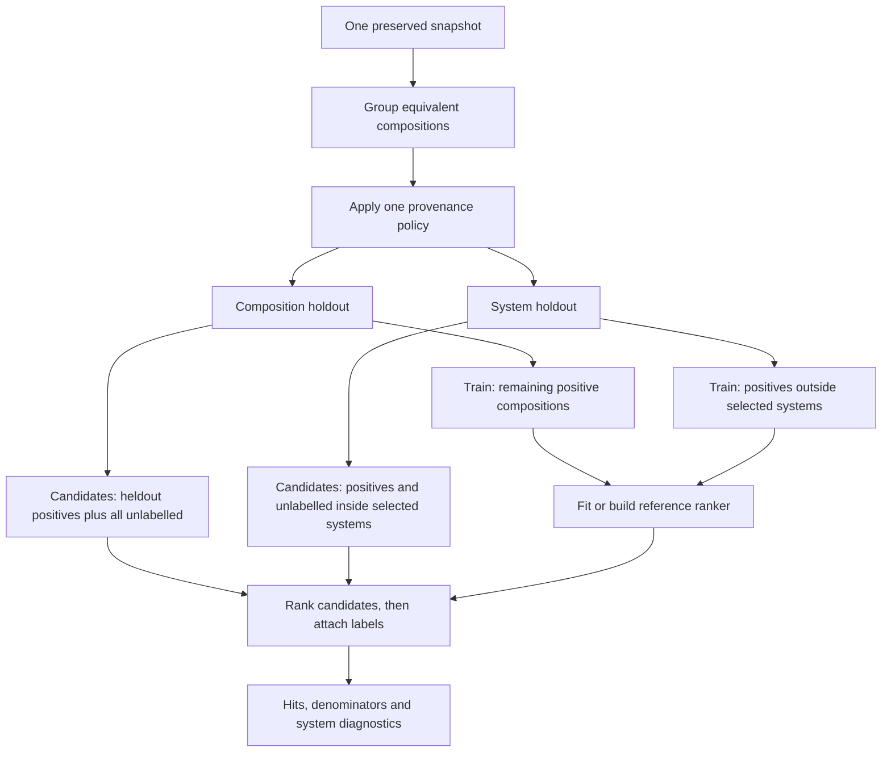

# Figure and table storyboard

Plan for **three main figures, two tables and one compact supplementary figure**. Design the figures alongside the Methods/Results paragraphs rather than after polishing the text. Only attributed aggregate results belong in the source planning directory; row-level derivatives stay under ignored local paths. Figures below are storyboards, not completed publication graphics.

Use identical method colors across panels, color-blind-safe styling, visible zero/reference lines and direct labels. Plot all 20 split values where useful; do not add confidence bands that imply independent repetitions. Label post-hoc panels. Keep original, exclude-mixed and unlabel-mixed visible together. Avoid raw-hit bar charts that invite comparisons across different candidate pools.

## F1 — Within-pool differences and the task behind them

- **Question:** Does the method comparison change with holdout design and label policy?
- **Takeaway:** Similarity and pair-model margins over popularity are conditional on the evaluation branch; cross-design raw counts answer different questions.
- **Source:** `reports/local/mp-system-holdout-v2-2026-08-31/analysis/paired-differences.tsv`, `method-summary.tsv`, `populations.tsv`; pair bundle's corresponding analysis tables. Original full `results/metrics.tsv` files provide all budgets and random realization/expectation.
- **Evidence exists:** yes, all required primary comparisons. New plotting only; validate figure data against per-split metrics, not hand-transcribed values.
- **Preferred:** two rows of facets for composition/system; columns for three policies. Each facet shows 20 paired differences for similarity−popularity and pair−popularity at K=100, with mean and median markers. Put mean N, h and prevalence in facet subtitles or T1; explicit zero line. A small adjacent enrichment panel can show prevalence-adjusted descriptive scale, if readable.
- **Alternative:** aligned slope plots joining methods within each split, split across six panels. This preserves pairing but may be cluttered; prefer dot distributions if lines overlap heavily.
- **Rough caption:** “Within-split differences in observed-positive Hits@100 relative to training-element popularity for two holdout procedures and three provenance-label policies. Dots represent the 20 predeclared, overlapping holdouts; markers summarize their mean and median. Zero indicates no difference. Comparisons within a panel share candidates and labels; different holdout designs do not. Variation is descriptive split sensitivity, not an inferential confidence interval.”
- **Supports:** C3–C5; R1/R2; D1.
- **Assembly check:** 6 branches × 2 contrasts × 20 dots = 240 plotted differences. Display unfavorable values as prominently as favorable ones.

## F2 — How many chemical systems stand behind composition hits?

- **Question:** Does a favorable composition hit count reflect broad system coverage or repeated hits within a few systems?
- **Takeaway:** Row counts and system coverage are distinct; the pair model's tie structure makes this a substantive limitation.
- **Source:** primary pair `analysis/system-concentration-*.tsv` and `subgroup-*.tsv` from the retained diagnostics bundle. For fair all-method panels, use each baseline ranking plus the same heldout membership (E1).
- **Evidence exists:** yes. The matched all-method table is in `reports/local/matched-system-metrics-2026-09-22/` (`system-metrics-by-split.tsv` for per-split dots, `system-metrics-summary.tsv` for means including the exact random expectation of hit systems); see file 10.
- **Preferred:** panel A shows per-split Hits@100 against distinct positive-hit systems for all methods; panel B shows system recall and effective hit systems by policy; panel C reports system-disjoint positive appearances in composition holdouts against analytical random expectations with denominators. Use aggregate counts, not record identifiers.
- **Alternative:** small-multiple cumulative hit-share curves across systems, ordered by each system's contribution. This conveys concentration well, but does not by itself show the fraction of relevant systems reached; retain system recall numerically.
- **Rough caption:** “System coverage and concentration behind top-100 composition recovery. Systems are unordered element sets. Effective hit systems equal H²/Σh_s² and quantify concentration, not independent sample size. The original pair-model lists average 13.5 selected and 9.0 positive-hit systems, corresponding to 5.68 effective hit systems. On the same pools, popularity, similarity and uniform-random lists reach 6.20, 23.75 and 40.15 positive-hit systems (random expectation 39.42) [E1, file 10; verify against the TSV at assembly]. The composition-holdout subgroup counts are positive appearances across overlapping splits, not distinct discoveries. These diagnostics were added after the primary evaluations.”
- **Supports:** C6/C7 and R3; limits C5.
- **Assembly check:** same K, candidates and relevant sets for every method; no selected-system count presented as validated chemical diversity.

## F3 — Optimization changes recommendations more than aggregate recovery

- **Question:** Can apparently stable mean performance mask different recommended candidates?
- **Takeaway:** Yes for the retained cap-sensitivity study, without showing that longer optimization is a scientifically superior model.
- **Source:** diagnostics `analysis/stability-by-fit.tsv`, `stability-summary.json`; original and stability fit diagnostics, rankings and objective traces.
- **Evidence exists:** yes; all 11 diagnostic-analysis outputs reproduced byte-identically in this investigation.
- **Preferred:** x-axis number of top-100 replacements; y-axis hit difference (20k−2k); all 120 fits, distinguished by original stopping status, with faceting by holdout and policy. Add a compact termination count panel (19 criterion reached, 101 capped; later all 120 criterion reached). Label overlapping points/counts.
- **Alternative:** paired top-100 Jaccard overlap and hit-delta distributions. Define Jaccard clearly; it is not currently a stored primary metric and would be a deterministic derived diagnostic.
- **Rough caption:** “Post-hoc sensitivity to increasing only the iteration cap from 2,000 to 20,000. Among 101 previously capped fits, 55 top-100 sets changed, with up to 48 replacements; the 19 already converged sets were unchanged. Hit changes averaged +0.16 (range −5 to +4). All longer-run fits reached the same projected-gradient criterion. The 2,000-iteration evaluations remain primary; stationarity does not imply a global optimum.”
- **Supports:** C8; R4; D3.
- **Assembly check:** 120 records, no fit omitted; annotate repeated identical alternative-policy fits rather than implying independence.

## T1 — Population and label-policy denominators

- **Question:** What is the evaluated population in each comparison?
- **Takeaway:** Policy and split construction alter training/candidate composition and the random baseline.
- **Source:** original audit; v2 `analysis/populations.tsv`; policy rules `mp_label_sensitivity.jl:14`; split rules `mp_system_holdout.jl:31`.
- **Evidence exists:** yes; table assembly remains E2.
- **Preferred:** six branch rows; eligible P/U, mixed handling, training mean/range, candidate N mean/range, heldout h mean/range, mean prevalence, common/selected systems and random expected Hits@100. Put scope/version/retrieval in caption. Move less essential fields to supplement if too wide.
- **Alternative:** data-flow count diagram plus narrow six-row denominator table. Avoid a decorative Sankey whose widths compare composition counts with structure counts.
- **Rough caption:** “Population definitions for one MP snapshot of oxygen-containing ternaries. The 24,020 source records collapse to 12,506 compositions. Counts are exact for composition holdout and summarized across the 20 selected-system partitions where variable. Original, exclude-mixed and unlabel-mixed apply different policies to the 1,343 mixed groups. Random expectations use each split's actual h/N.”
- **Supports:** C1/C3; M1–M3; R1.

## T2 — Main outcomes and evidence identity

- **Question:** Which measured numbers support the argument and which experiment produced them?
- **Takeaway:** Conditional means, paired margins and traceable configurations support a limited empirical conclusion.
- **Source:** pair/system analysis `method-summary.tsv`, `summary.tsv`, configuration hashes, source/protocol identities in file 01.
- **Evidence exists:** yes. Main numeric content can start from the anchor table in file 02.
- **Preferred:** six rows with random expectation/realization, four-method Hits@100 and pair-minus-popularity sign counts; include mean enrichment in a second panel if needed. Footnote identifies primary versus later diagnostics and points to supplementary per-run identities.
- **Alternative:** move most means into F1 and use T2 as the three-claim evidence matrix with effect, caveat and source artifact. Do not duplicate a large figure and table without a distinct purpose.
- **Rough caption:** “Primary top-100 recovery on identical within-branch candidate pools. Entries are means across overlapping holdouts; sign counts refer to paired model-minus-popularity differences. Scores and metrics measure withheld provenance labels, not synthesis. Full configurations and all secondary cutoffs accompany the supplementary record.”
- **Supports:** C3–C5/C9; R2/R5.

## S1 — Secondary budgets and full sensitivity grid

- **Question:** Are the main-cutoff observations robust to the other frozen cutoffs?
- **Takeaway:** Budget dependence is part of the result; K=100 does not define a universal ordering.
- **Source:** complete metric grid, per-budget paired summaries, and label-sensitivity `evaluation_only` and `full_pipeline` summaries kept separate.
- **Evidence exists:** yes. These are existing outcomes, not a new hyperparameter search.
- **Preferred:** paired-difference versus K=20/50/100/200, per method contrast and policy, with split traces or descriptive min/max clearly labelled. Add a separate label-mode panel or supplementary table.
- **Alternative:** heatmap of mean signed differences with all 20 differences in an accompanying machine-readable local table.
- **Rough caption:** “All frozen budgets and both label-sensitivity modes. Lines describe the same overlapping partitions at different cutoffs, not independent measurements. Evaluation-only relabelling retains original training information and must not be interpreted as a newly trained alternative-policy experiment.”
- **Supports:** C3/C4 and guards against selective reporting.

## Optional explanatory diagram, only if Methods needs it

This conceptual sketch is editable and has no measured quantities. Prefer this small split diagram over a general architecture poster; its purpose is to make the confounder visible.

Caption if used: “The two holdouts differ in both separation unit and candidate pool; labels are evaluator inputs after ranking.” Alternative: a two-column pseudo-code box. Supports M3/M4, not a separate scientific result. Keep it in the supplement unless a reader walkthrough shows confusion.
